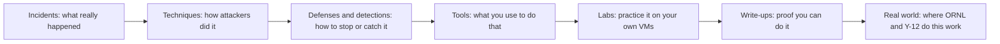

# Cyber Learning Atlas

A curated, agent-friendly study database for learning cybersecurity by doing. It links real attack techniques to the defenses that stop them, explains real incidents in plain words, rates open-source tools for a home lab, and gives you a step-by-step lab path you can run on your own Mac in virtual machines.

Built for one learner: a high school student on the Security+ and Network+ path with a Mac mini, UTM virtual machines (Parrot OS) and a Cisco 1941 router. Anyone else is welcome to use it too.

> Independent learning project. Not affiliated with, sponsored by or endorsed by MITRE, CISA, NIST, ORNL, Y-12 or any company or tool listed here. Public sources only. Last full check: 2026-11-22.

## Start here (pick one)

| If you want to... | Go to |
|---|---|
| Get your hands dirty this weekend | [Lab 0: build a safe lab](labs/00-safe-lab-setup.md), then [Lab 1: map your own network](labs/01-map-your-own-network.md) |
| Understand how real attacks work and how they get caught | [Technique to defense map](techniques/README.md) |
| Learn from real breaches | [Incidents in plain words](incidents/README.md) |
| Pick tools for a home lab | [Tools catalog](tools/README.md) |
| Practice on legal hacking sites | [Practice platforms](practice/README.md) |
| Read the good stuff (reports, talks, NIST) | [Research and talks](research/README.md) |
| Connect this to ORNL and Y-12 | [Real world layer](real-world/README.md) |
| Look up a word | [Glossary](GLOSSARY.md) |

**Key takeaway:** reading builds vocabulary, but labs build skill. The fastest path is one lab per week, plus a short write-up for each one. Ten honest write-ups beat a hundred bookmarks.

## How the pieces fit



## What is in here

| Folder | What it holds |
|---|---|
| [techniques/](techniques/README.md) | 22 common MITRE ATT&CK techniques, each paired with D3FEND defenses, what to log, and a lab to practice it. Plus how to use the CISA Known Exploited Vulnerabilities list. |
| [incidents/](incidents/README.md) | 17 real incidents from 2015 to 2026, explained simply, with the lesson and what to practice. Plus the big yearly reports. |
| [tools/](tools/README.md) | 28 free and open-source tools with what each does, difficulty, license, activity, and whether it runs on an Apple Silicon Mac. |
| [practice/](practice/README.md) | 13 legal practice platforms with cost and level, plus free cert study resources. |
| [research/](research/README.md) | NIST guides, frameworks, yearly reports, conference talks and research feeds worth your time. |
| [labs/](labs/README.md) | A setup lab plus 12 hands-on labs, Security+ level and up, each with goal, setup, steps and what to write up. |
| [real-world/](real-world/README.md) | How each topic shows up in ORNL and Y-12 public work, linked to the ORNL atlas. |
| [index/](index/) | `entries.csv` and `entries.json`: all 158 entries, with type, topic, level, source URL and date checked. Built for agents and scripts. |
| [scripts/](scripts/) | The repo checker, the index builder and a small KEV lookup tool. |

## Evidence tags

Claims are tagged the same way as the ORNL atlas:
- **[KNOWN]** stated directly in the linked public source.
- **[INFERRED]** our reasoning from the sources, not stated outright.
- **[UNKNOWN]** looked for, not found in public sources.

## Using this with an AI agent

Point Codex, Claude, Hermes or Grok Bot at this repo and tell it to read [AGENTS.md](AGENTS.md) first. A good starter prompt:

```
Read AGENTS.md in this repo first. Then act as my cyber lab coach.
Pick the next lab I haven't done from labs/README.md, walk me through it
step by step on my own VMs, quiz me on the matching techniques in
techniques/README.md, and help me write the lab write-up when I'm done.
```

## Rules

Public info only. No live exploit code or malware in this repo. Labs run only on machines you own, inside an isolated lab network. No claims of affiliation. No personal info about individuals. Full rules are in [AGENTS.md](AGENTS.md) and [labs/SAFETY.md](labs/SAFETY.md).

## License and credit

Our own writing is licensed under CC BY 4.0 and our scripts under MIT (see [LICENSE](LICENSE)). Third-party frameworks and data keep their own licenses. See [NOTICE.md](NOTICE.md) for MITRE ATT&CK, D3FEND and CISA KEV credit.
